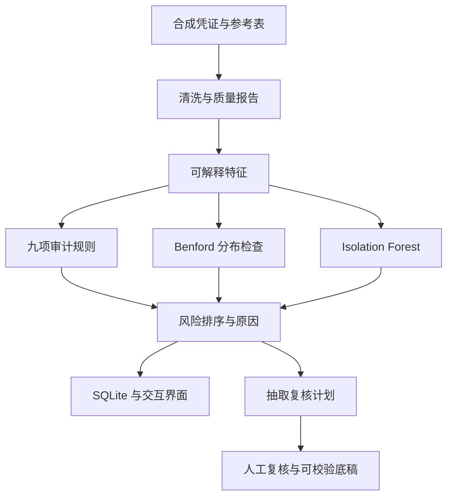

# AuditLens｜从总账异常到可复核的审计底稿

[English](README.md) · [架构与方法](docs/architecture.md) · [查看界面截图](docs/screenshots/01_executive_overview.png)

**面对三万笔凭证，先查哪些，为什么查，复核结论如何回到证据？**

AuditLens 把数据清洗、九项审计规则、Benford 分布检查、Isolation Forest 和可解释的风险排序串成一个批处理流程。分析人员通过 Streamlit 界面查看线索，并把人工复核写入可以校验的工作底稿。

**数据是固定种子生成的合成总账。** 异常标签用于检验方法，界面不把答案暴露给复核人员。规则命中、模型分数与 Benford 偏离都是待调查线索。

## 一分钟看懂流程



| 需要判断的问题 | 实际实现 | 代码或证据 |
| --- | --- | --- |
| 原始数据有哪些问题？ | 重复、金额、日期、外键和科目检查；保留质量报告 | [清洗模块](src/data_cleaning.py) |
| 为什么这笔凭证值得看？ | 九项规则及逐条命中原因，结合模型与分布分数排序 | [规则](src/audit_rules.py) · [风险评分](src/risk_scoring.py) |
| 复核名额如何分配？ | 高风险定向选取与明确区分的随机样本 | [复核计划](src/review_plan.py) |
| 复核表被改坏了怎么办？ | 核对原选择记录、CSV 原始字段和完整性，再汇总人工结果 | [复核底稿](src/review_outcomes.py) |

## 当前保存的结果，应该怎样解释？

清洗后有 **30,128 笔凭证**，九项规则标记 **2,139 笔**供进一步审阅；其中 **248 笔**为高风险或严重风险。它们是线索数量，不是已证实的舞弊数量。

规则命中 919 个注入异常中的 902 个，不能据此宣称真实业务召回率为 98.2%：异常正是按这些规则的定义注入的。Isolation Forest 单独多找到 2 个异常；公开保留这一结果，避免把规则和模型的重合命中当成新增发现。

完整数值、误报和方法限制见[英文结果说明](README.md#headline-results)。

## 本地运行

需要 Python 3.11+ 和 Git；安装依赖时需要网络。先克隆并进入项目：

```bash
git clone https://github.com/dev-belly/AuditLens.git
cd AuditLens
```

**Windows PowerShell**

```powershell
python -m venv .venv
.\.venv\Scripts\python.exe -m pip install -r requirements.txt
.\.venv\Scripts\python.exe src/run_pipeline.py
.\.venv\Scripts\python.exe -m streamlit run dashboard/app.py
```

**Linux / macOS**

```bash
python -m venv .venv
.venv/bin/python -m pip install -r requirements.txt
.venv/bin/python src/run_pipeline.py
.venv/bin/python -m streamlit run dashboard/app.py
```

命令直接使用虚拟环境，不依赖激活脚本或 `make`。流水线会生成本地数据和报告，请在单独的工作副本中运行。界面用于审阅线索，人工结论需要证据支持。

架构图使用可渲染的 Mermaid，正文使用原生中文文本；编辑器保存时选 UTF-8。图表的系统字体选择与回退见[报告模块](src/reporting.py)。无法渲染 Mermaid 的客户端可以继续看上面的流程表和[分阶段说明](docs/architecture.md#stage-by-stage-responsibilities)。
